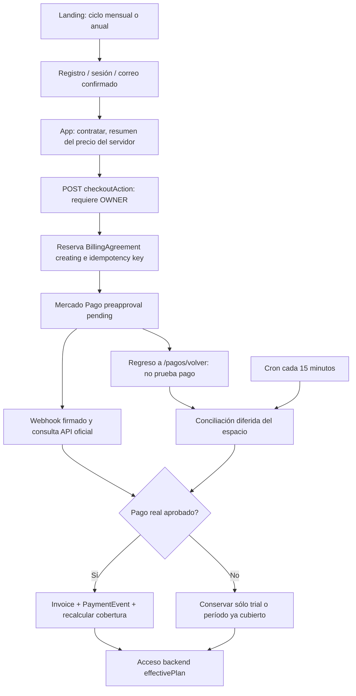

# Auditoría de pagos, suscripciones, trial y finanzas

Fecha: 15 de noviembre de 2026. Revisión local del código actual, sin modificar producto ni producción. No hubo cobros, bajas, reembolsos ni accesos a APIs reales. Las cancelaciones mencionadas en pruebas afectan exclusivamente objetos ficticios en memoria.

## Arquitectura y autoridad

Mercado Pago es la integración identificada, mediante su API REST y autorizaciones `preapproval`; no se emplea un SDK de pagos. `src/server/billing.ts:29` usa Bearer, timeout de 10 s, sin caché y sin redirects. Precios ARS provienen de `AppSetting/plans`, no del importe del navegador (`billingConfig`, `startCheckout`). El navegador indica ciclo/cupón; el servidor calcula y guarda importe/frecuencia. `expectedAmount` detecta una pantalla con precio desactualizado, pero omitirlo no permite cambiar el precio real.

El dominio usa tres dimensiones diferentes:

| Dimensión | Persistencia / autoridad | Función |
|---|---|---|
| Contrato de cobro | `BillingAgreement`, API `/preapproval` | Acuerdo mensual o anual, importe original, cupón y próximo débito |
| Pago | `Invoice`, `/authorized_payments` y `/v1/payments` | Estado aprobado/rechazado/reembolsado/contracargo, período y datos financieros |
| Acceso | `Subscription` y `effectivePlan()` | Trial, cobertura aprobada y concesión manual; no basta una autorización |
| Contabilidad de eventos | `PaymentEvent` | Bruto, reversión y recuperación por fecha; evita mover retrospectivamente el cobro al mes del reembolso |
| Comunicaciones | `EmailOutbox` | Cola transaccional, lease, reintento y clave de deduplicación |

Un único `Subscription` por espacio no equivale a un solo registro histórico de contrato. Los contratos históricos se conservan hasta borrar el espacio. Las operaciones del mismo espacio usan `SELECT ... FOR UPDATE` (`billing.ts:35-40`), con transacción de hasta 60 s.



## Contratación, recuperación y controles verificados

- `checkoutAction`, `src/app/actions/modules.ts:673-711`: requiere titular y correo confirmado, valida ciclo, consulta cupón en servidor y construye retorno con espacio autenticado.
- `startCheckout`, `billing.ts:61-119`: calcula precio desde configuración, bloquea reserva concurrente, reutiliza condiciones idénticas y exige confirmación explícita para sustituir una solicitud sin pagar. Una reserva `creating/uncertain` bloquea un POST nuevo.
- El POST de creación lleva `X-Idempotency-Key` igual al ID de reserva. Ante timeout queda `uncertain`; recuperación busca por pagador y referencia completa antes de permitir otro intento (`billing.ts:161-184`). La efectividad real del header en este endpoint y la consistencia de búsqueda del proveedor requieren contrato/sandbox oficial; los tests no prueban esas garantías externas.
- Webhook `src/app/api/pagos/mercadopago/route.ts:5-23`: rechaza ID URL/cuerpo discrepante, HMAC y timestamp fuera de ventana; en error devuelve 500 para reintento. No posee una bandeja persistida de recepción de eventos: la recuperación depende de reintento y conciliación de estados actuales.
- `applyPreapproval`, `billing.ts:229-279`: consulta API oficial, exige referencia local conocida, comprueba importe/moneda/frecuencia, compara versión del proveedor y evita resucitar acuerdos cancelados.
- `applyPayment`, `billing.ts:281-344`: relee autorización y pago real, valida importe y moneda, trata reembolso total/parcial, usa claves únicas y conserva período de factura ya finalizada ante repetición.
- `src/app/pagos/volver/route.ts`: el retorno requiere sesión, segundo factor cuando corresponde y espacio del titular. Query `approved` no concede acceso. Navegación vuelve a la app y concilia mediante `after()`.
- `reconcileBilling`, `billing.ts:377-402`, y `runBillingMaintenance`: consulta estado actual; su lease reduce cron simultáneo. `vercel.json` solicita ejecución cada 15 minutos. Esto prueba configuración en repo, no ejecución real del scheduler ni SLA del proveedor.

## Trial y calendario

`startFreeTrial`, `src/server/plans.ts:15-25`: el titular activa explícitamente 14 × 24 h, sin tarjeta, una vez por Workspace; no se inicia automáticamente al registrarse. Bloquea trial anterior, proveedor MP, plan distinto de Gratis, baja en curso o acuerdo no cancelado. No hay verificación de identidad que garantice una prueba por persona entre múltiples cuentas; es riesgo comercial, no fallo de unicidad por espacio.

`effectivePlan`, `plans.ts:47-55`, calcula vencimiento durante cada autorización backend: no depende de que el usuario abra la app ni de un cron para dejar de ser Pro. Los datos no se borran al vencer. Una compra durante trial programa `start_date` para el máximo de trial y cobertura pagada (`billing.ts:99-101`). Autorizar antes del primer cobro preserva la prueba, pero no crea cobertura paga por sí solo. Primer pago fallido deja sólo cobertura previa; sin cobertura se vuelve Gratis.

`paidUntil`, `plans.ts:58-65`, usa calendario de meses/años, limita día al último del mes y admite offset del proveedor. Hay tests de 31 de enero, año bisiesto, 29 de febrero y cruce de medianoche. Cuando `next_payment_date` es compatible con la duración del ciclo, el proveedor define el cierre de factura; si no, se usa calendario local calculado. Reintentos tardíos y cambios de zona deben comprobarse contra fixtures oficiales, no sólo contra mocks de la aplicación.

`access-notices.ts`: avisos de trial por terminar/terminado con deduplicación y supresión si cambió el estado. No hay un período de gracia comercial independiente; `PAST_DUE` mantiene únicamente cobertura ya vigente. No agregar un estado de gracia sin definir antes una política.

Recomendación comercial: conservar Gratis permanente + trial explícito sin tarjeta de 14 días; reduce complejidad y sorpresas, mantiene posibilidad de conversión anual/mensual. Medir activación y conversión de cohortes antes de probar otro modelo. Referidos otorgan créditos con tope, correo confirmado y primera acción (`referrals.ts`, `referral-credit.ts`); aún es posible crear múltiples identidades/correos propios para obtener premios. Proponer señales de abuso proporcionales, sin bloquear familias ni exigir datos excesivos.

## Máquina de estados actual y reglas recomendadas

La máquina real tiene dimensiones separadas; sumar todos los casos a un solo enum introduciría estados imposibles.

| Entidad | Estados reales | Transiciones permitidas y condiciones |
|---|---|---|
| Acuerdo | creating → pending / uncertain | Reserva antes de POST; timeout → uncertain |
| Acuerdo | uncertain → pending / cancelled | Conciliación encuentra coincidencia; ausencia suficientemente antigua permite liberar reserva |
| Acuerdo | pending → authorized / cancelled | Sólo API proveedora, o descarte explícito confirmado por proveedor |
| Acuerdo | authorized ↔ paused, authorized/paused → cancelled | Estado consultado al proveedor; cancelación terminal local no revive por webhook atrasado |
| Suscripción | ACTIVE, TRIALING, PAST_DUE, CANCELED | Enum describe contrato/acceso de forma parcial; `effectivePlan` usa fechas y origen |
| Acceso derivado | Gratis, trial, pago vigente, concesión | Depende de reloj servidor, trial o facturas aprobadas/cobertura manual |
| Pago | pending / in_process / approved / rejected / cancelled / refunded / charged_back | Proveedor autoritativo; versión evita retroceso, reversión elimina sólo cobertura de ese pago |

Prohibido: activar pago por query de retorno, por autorización sin factura aprobada, por pago rechazado, por ID de otro espacio, por importe/moneda diferente o por webhook obsoleto que revive un acuerdo cancelado. Confirmado en código y pruebas simuladas.

Cancelación no borra datos y no revoca cobertura pagada. Reactivación se realiza mediante una contratación nueva luego de una cancelación, programada tras la cobertura vigente; no existe una función autónoma para reactivar el mismo contrato en MP. Upgrade mensual → anual crea otro contrato con inicio diferido y detiene el mensual al autorizar el anual. No hay prorrateos. No se ofrece cambio anual → mensual automático; es una capacidad comercial incompleta que debe explicarse, no un bug de cálculo. Downgrade a Gratis deriva del vencimiento o cancelación al final del período; recursos existentes permanecen, y crear recursos adicionales usa límites del plan.

## Hallazgos priorizados

### PAG-01 — Alto / P1: borrar cliente elimina el historial financiero empresarial

**Confirmado por código y reproducción aislada.** `admin-accounts.ts:86` borra Workspace. `schema.prisma:828` elimina Invoice en cascada, y `schema.prisma:1014` elimina PaymentEvent en cascada. Así se pierden cobros, devoluciones y datos que sustentan finanzas/cohortes; una baja posterior cambia retrospectivamente cifras históricas. No se comprobó pérdida real en producción.

Prueba PGlite ficticia: antes de borrar espacio había 1 Invoice y 1 PaymentEvent; después quedaron 0 y 0. No se ejecutó borrado de cuentas reales.

Solución: separar ledger de la vida del Workspace, conservar identificadores y hechos económicos mínimos mediante pseudonimización/anonimización según política legal; no mantener datos personales por defecto. Resolver referencia opcional y procedimientos antes de cambiar FKs. Tiempo 2–4 días más revisión contable/legal; complejidad media/alta. Validación: eliminar cuenta ficticia pagadora preserva totales de meses históricos y documentos con retención aplicable, sin acceso a datos privados ni posibilidad de renovar.

### PAG-02 — Medio / P1: un anual pendiente oculta MRR mensual todavía activo

**Confirmado por reproducción aislada.** `admin-metrics.ts:43-53` usa sólo el último BillingAgreement. `public-plan.ts` prioriza `pending` como estado único de facturación; `overview` suma MRR únicamente si el estado es active/scheduled. Crear solicitud anual pendiente no detiene el mensual autorizado, pero deja de contabilizarlo.

Salida observada: antes `mrr:7499, paid:1`; después de agregar anual pendiente `mrr:0, paid:1, pending:1`. No significa cobro perdido; significa métrica incorrecta que puede inducir decisiones empresariales equivocadas.

Solución: obtener contrato activo por `subscription.providerRef` separadamente del checkout candidato. MRR usa el contrato recurrente vigente y solicitud pendiente se mide por otro eje. Complejidad baja/media, 0,5–1 día. Validación: mensual con pago vigente + anual pendiente conserva MRR7499; tras autorización anual pasa al anual/12 sin sumar ambos.

### PAG-03 — Medio / P2: una baja genera dos correos distintos

**Confirmado con PGlite y fetch totalmente simulado.** `billing.ts:212` encola `cancel-<refs>` desde cancelSubscription; el webhook posterior encola `subscription-<id>-cancelled` en `billing.ts:277`. Son dedupeKeys distintas para la misma cancelación. Resultado: después de acción 1 fila; después de webhook 2 filas, asuntos “Cancelaste tu suscripción…” y “Suscripción cancelada…”. No se enviaron correos reales.

Solución: evento canónico de baja por contrato/transición, compartido entre acción y conciliación. Diferenciar baja de solicitud sin pago. Complejidad baja, 0,5 día. Validación: acción + webhook repetido + cron dejan un aviso de baja, preservando dos avisos cuando existieron dos transiciones reales diferentes.

### PAG-04 — Medio / P1 de confiabilidad: conciliación sin cursor interno ni presupuesto estricto

**Riesgo confirmado por estructura, no fallo operativo medido.** `billing.ts:357-366` recorre historial completo, y para cada pago consulta otra vez autorización/pago real y actualiza DB. `reconcileBilling:377-400` comprueba deadline únicamente entre acuerdos. Un acuerdo extenso o API lenta puede exceder presupuesto y duración serverless. No hay cursor persistido de pagos ni punto de reanudación interno. Se toman hasta 40 acuerdos vigentes y 2 cancelados por cron cada15min; el máximo nominal de vigentes es3840/día antes de fallos y del presupuesto. Con100k acuerdos, un recorrido nominal tardaría26 días, no15min. Es estimación matemática, no load test.

Solución: cursor persistido y reconciliación incremental, cola por acuerdo/evento con prioridad en vencimientos y discrepancias, barrido histórico de menor frecuencia y dead-letter. Pasar deadline a loops internos. Evitar API remota bajo locks largos mediante saga/revalidación corta, conservando idempotencia. Complejidad media/alta, 3–7 días. Validación: proveedor simulado con latencias,429,500 y miles de pagos, corte/retorno seguro y métricas de antigüedad máxima.

### PAG-05 — Medio / P2: ciclo de facturación del cliente parcialmente incompleto

**Confirmado por interfaz/código.** `configuracion/page.tsx` muestra últimas24facturas sin paginación, estado y monto; no ofrece recibo fiscal descargable ni actualización del medio de pago mediante enlace contextual de proveedor. `SubscriptionSummary` pide revisarlo en MP o Ayuda. No hay reactivación del mismo contrato ni downgrade anual→mensual autónomo. No afirmar que un recibo MP equivale a comprobante fiscal: el panel distingue esto correctamente.

Solución: paginar historial; incluir identificadores útiles y acceso al comprobante permitido; guía o enlace validado para método de pago, automatización fiscal por separado; política explícita de cambios de ciclo. Complejidad media, 2–5 días por alcance externo. Validación: estados simulados de usuario pago/rechazado/cancelado y proveedor en sandbox.

### PAG-06 — Medio / P2: efectos externos dentro de transacciones requieren compensación y observabilidad

**Riesgo potencial identificado, sin duplicado real demostrado.** `billing.ts:78-94, 209, 253-262` hace GET/PUT a MP dentro del lock de Workspace. La DB puede hacer rollback después de que MP haya cancelado un acuerdo; el rollback no revierte la API. Hay conciliación y compensación parcial para cambio anual, lo que reduce riesgo, pero no un registro durable de pasos externos ni alarma inmediata de compensación fallida. La falta de atomicidad distribuida debe tratarse como diseño de saga, no prometer una transacción ACID entre proveedor y DB.

Solución: intención durable, pasos y compensación persistidos, reconcile de discrepancias, alarmas y estado UX “verificando”. Complejidad media/alta, 3–5 días. Validación: inyectar fallo DB después del PUT exitoso, reiniciar proceso, demostrar convergencia sin segundo contrato ni acceso indebido.

### PAG-07 — Bajo / P3: presupuesto de correos e idempotencia externa no equivalen a entrega exactamente una vez

**Riesgo potencial.** `billing-mail.ts:26` usa lease60s y `sendEmail` usa idempotency key de Resend. Una aceptación remota seguida de fallo DB se reintenta. La [documentación oficial de Resend](https://resend.com/changelog/idempotency-keys) establece conservación de claves por24horas: un reintento posterior no tiene esa garantía de deduplicación. Además el destinatario de un aviso de facturación queda capturado al encolar; sólo avisos `access/` revalidan destinatario/estado al enviar. Definir entrega incierta, destinatario actual y política de reenvío; no llamar a la cola “exactly once”. No se ejecutó falla remota real ni se obtuvo SLA contractual de Resend.

## Evidencia de ejecución

Comando ejecutado localmente:

```text
npx vitest run tests/billing.test.ts tests/billing-state-regressions.test.ts tests/business-finance.test.ts tests/billing-mail.test.ts tests/billing-return.test.ts tests/billing-return-route.test.ts tests/public-plan.test.ts tests/plan-subscription-card.test.ts
Test Files 8 passed (8)
Tests 120 passed (120)
Duration 28.47s
```

Pruebas con fetch interceptado y PGlite aislado. No son Mercado Pago sandbox ni pruebas de navegador. El helper `tests/helpers/testdb.ts` crea PostgreSQL PGlite en memoria con migraciones reales del repo y pool máximo1. Esto valida lógica y SQL, pero no reproduce múltiples procesos de producción ni el aislamiento de PostgreSQL remoto. El test de dos solicitudes concurrentes (`billing.test.ts:246`) serializa sobre esa configuración de conexión; se necesita también prueba de dos clientes/procesos independientes.

Reproducciones nuevas ejecutadas desde script temporal externo al producto, con espacio/correos/IDs ficticios y fetch que rechaza rutas no simuladas:

```json
{"proof":"pending annual changes active monthly MRR","before":{"mrr":7499,"paid":1},"after":{"mrr":0,"paid":1,"pending":1}}
{"proof":"ledger before workspace deletion","invoices":1,"events":1}
{"proof":"same cancellation creates two outbox notices","afterAction":1,"afterWebhook":2,"subjects":["Cancelaste tu suscripción a somosguafra Pro","Suscripción cancelada · somosguafra Pro"],"dedupePrefixes":["cancel","subscription"]}
{"proof":"workspace cascade deletes financial ledger","invoicesRemaining":0,"eventsRemaining":0}
```

## Matriz mínima de28escenarios

“Pasó simulado” significa suite local ejecutada; “parcial” no valida proveedor/navegador real. No existe una pasada E2E oficial de estos28casos en esta auditoría. Riesgo residual de todo caso de dinero: contrato externo y concurrencia multiinstancia pendientes.

| # | Estado inicial → acción | Esperado / estado final | Observado y evidencia | Estado / riesgo / validación pendiente |
|---|---|---|---|---|
|1|Nuevo sin suscripción → cálculo de acceso|Gratis, no acceso pago|`public-plan.test.ts:36`, `effectivePlan`; lectura de creación Workspace Gratis|Parcial, falta navegación registro completo|
|2|Gratis → intentar plan/función|Permisos backend y oferta correcta|`public-plan.test.ts:36`; pagos no conceden acceso por UI|Parcial; autorización por todas las funciones corresponde a auditoría de seguridad|
|3|Gratis elegible → iniciar trial|Pro14d sin tarjeta, una vez|`billing.test.ts:220` pasó|Simulado; repetir desde navegador pendiente|
|4|Trial vence → consulta backend|Gratis exactamente al límite, datos permanecen|`public-plan.test.ts:79,85` pasó|Simulado; política de recursos excedidos a revisar por módulo|
|5|Sin cobertura → pago aprobado|Invoice válida y Pro hasta período|`billing.test.ts:235` pasó|Simulado; falta sandbox oficial|
|6|Sin cobertura → pago rechazado|No Pro ni ingreso|`billing.test.ts:85`, regressions pending/rejected pasó|Simulado; error UI oficial pendiente|
|7|Sin cobertura → pending/in_process|No extender acceso|`billing-state-regressions.test.ts:74` tabla pasó|Simulado|
|8|Pago aprobado → mismo pago otra vez|No sumar período ni ingreso|`billing.test.ts:269` pasó|Simulado; falta webhook multiinstancia|
|9|Webhook repetido|Misma factura/estado, no duplicar evento|`billing.test.ts:269`, `business-finance.test.ts:42` pasó|Simulado; baja sí duplica aviso PAG-03|
|10|Webhook perdido/demorado → conciliar|Estado actual recuperado sin cobro nuevo|regressions reconciliación paginada, return tests pasó|Parcial; cron real y demora SLA no comprobados|
|11|Pago llega antes autorización / aprobado viejo tras refund|Conciliar contrato; no revivir refund|`billing.test.ts:215,299` pasó|Simulado|
|12|Pago previo → renovación aprobada|Nuevo período, sin doble mes|`billing.test.ts:269` pasó|Simulado; calendario proveedor sandbox pendiente|
|13|Cobertura vigente → renovación rechazada|Conservar cobertura, luego Gratis|`billing.test.ts:277`, public-plan:71 pasó|Simulado; reintentos/tarjeta vencida externos no ejecutados|
|14|Suscrito → cancelar inmediatamente renovación|PUT remoto, acceso pagado vigente|`billing.test.ts:260`, regressions cancel confirm pasó|Simulado; cancelar acceso inmediato no es política actual|
|15|Cancelado → llegar fin período|Gratis sin nueva renovación|`public-plan.test.ts:28,85`, effectivePlan|Simulado; scheduler proveedor no ejecutado|
|16|Cancelado con cobertura → volver a contratar|Contrato nuevo inicia tras cobertura|`public-plan.test.ts:75`, billing fecha inicio pasó|Parcial; no existe reactivar mismo contrato|
|17|Mensual activo → anual|Inicio diferido, parar mensual al autorizar|`billing.test.ts:320,333` pasó|Simulado; MRR durante solicitud falla PAG-02|
|18|Pro → downgrade Gratis|Vencimiento conserva datos y limita nuevas operaciones|effectivePlan y pruebas vencimiento pasaron|Parcial; anual→mensual autónomo no disponible|
|19|Navegador cerrado → webhook pago|Acceso se activa sin retorno|applyNotification ejecutado directamente en billing:235|Simulado backend; no cierre de navegador real|
|20|DB cae después de operación proveedor|Recuperar sin cobro doble ni perder baja|No prueba dedicada de este corte distribuido|No ejecutado; PAG-06, inyección segura requerida|
|21|Aprobado → refund total/parcial|Total revoca su período; parcial lo conserva|`billing.test.ts:284,290,307` pasó|Simulado; no reembolso real|
|22|Aprobado → contracargo / recuperación|Revocar/restaurar con eventos históricos|`billing.test.ts:314`, business-finance:63 pasó|Simulado; disputa pendiente distinta de charged_back no testeada|
|23|Dos pestañas contratan|Una reserva y contrato|`billing.test.ts:246` pasó|Parcial; pool1 no reproduce multiproceso|
|24|VIEWER/EDITOR → contratar o cancelar|Prohibido al no titular|plan-card:50, return:19 y acciones requireOwner|Parcial; suite de permisos funcionales separada|
|25|Cliente manipula precio/plan/retorno|Validación servidor y no activar por query|`billing.test.ts:80,348`, return-route:33 pasó|Simulado|
|26|MP falla al cancelar/cambiar|No declarar baja confirmada, preservar vínculos|`billing.test.ts:158,333,360` pasó|Parcial; create timeout/429 repetido sin sandbox|
|27|MP autorizado, DB vieja → conciliación|Actualizar contrato sin regalar pago|`billing.test.ts:208`, regressions autorización pasó|Simulado; cron real pendiente|
|28|MP cancelado, DB activa → conciliación|Parar renovación y preservar cobertura|`billing.test.ts:341` y applyPreapproval inspeccionado|Parcial; falta prueba dedicada de corte/recuperación externa|

## Riesgos económicos y prioridades

No se encontró en las rutas inspeccionadas que precio de cliente o query del retorno active Pro indebidamente. Hay controles concretos de referencia, importe, moneda, reloj, versión e idempotencia. No se concluye que cobros duplicados sean imposibles: no se verificó contrato real del proveedor, dos procesos independientes ni fallas entre API y commit DB.

Primero preservar trazabilidad financiera al borrar cuentas (PAG-01) y arreglar métricas del contrato activo (PAG-02); después deduplicar bajas (PAG-03), endurecer recuperación y alertas (PAG-04/06) y cerrar autoservicio de facturación (PAG-05). No cambiar por esta auditoría comisiones, precios, trials o contratos existentes.

Monitoreo propuesto: acuerdos creating/uncertain >5min; discordancia contrato externo/local; webhook500 y firma inválida por minuto; edad del acuerdo más antiguo sin conciliar; múltiples contratos autorizados por Workspace; pagos con referencia/importe inesperado; próximos vencimientos sin cobertura; outbox crítico no enviado >15min. Alarmas requieren umbral adaptado al volumen; nunca lanzar cancelaciones o reembolsos automáticos como reparación indiscriminada.

Próxima validación de máxima prioridad: staging con PostgreSQL real multi-conexión, fixtures firmados oficiales y sandbox MP/Resend; pruebas de crash después de POST/PUT antes del commit, reintentos largos y eventos de distinto orden. La auditoría no obtuvo acceso a sandbox ni lo configura automáticamente. No se comprobó configuración real de comisiones, acreditación18d, facturación ARCA, ejecución de cron ni restauración de backup mediante esta subauditoría.

## Contraste con documentación primaria

La [referencia oficial de creación preapproval](https://www.mercadopago.com.ar/developers/en/reference/online-payments/subscriptions/create-preapproval/post) y la [guía de pago pendiente](https://www.mercadopago.com.ar/developers/es/docs/subscriptions/integration-configuration/subscription-no-associated-plan/pending-payments) describen el recurso utilizado. La [guía oficial de webhooks de suscripciones](https://www.mercadopago.com.ar/developers/en/docs/subscriptions/additional-content/your-integrations/notifications/webhooks) documenta firma y temas de autorización/pagos. Se contrastó el diseño de firma/API, pero no la configuración real de notificaciones ni una entrega oficial: ambas deben validarse en sandbox con los formatos reales del proveedor.
