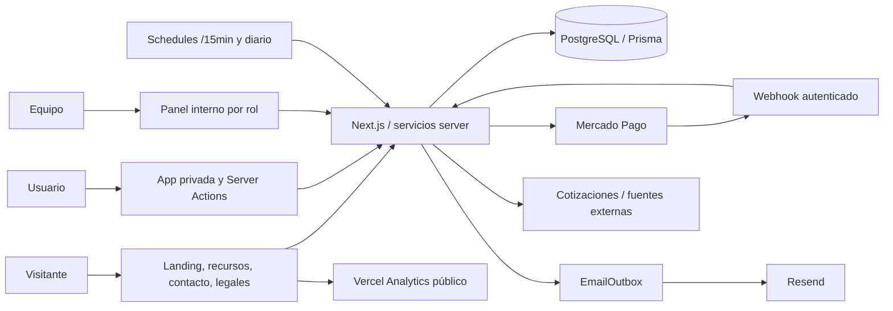

# Producto, arquitectura, rendimiento y operación

Auditoría del código en `d05880ea36d8d0a6dbb951e7913969f5d07dee3a`, 15/11/2026. Solo lectura del sistema; este documento no cambia producto ni infraestructura. Las comprobaciones de esta sección son estáticas. No hubo navegador disponible, recorrido visual actual, facturas de servicios, prueba de carga ni acceso a configuración de proveedores. Los resultados de tests y compilación ejecutados por la auditoría principal se documentan por separado.

## Arquitectura detectada

Monolito modular Next.js 16.4.6 App Router, React 19.3.1, TypeScript 5.9.3; Node >=20.19 (CI Node22). Backend en Server Components, Server Actions y Route Handlers; Prisma 7.10.1 con adapter `pg` contra PostgreSQL. PGlite 0.5.16 se utiliza para pruebas locales. `package.json`, `src/lib/db.ts:8-17`, `vitest.config.mts`.

54 modelos Prisma y 25 directorios de migraciones. Los dominios principales son identidad/sesiones, Workspace/Membership, contabilidad personal, tarjeta/deuda, planificación, inversiones/agro, contratación y pagos, soporte, administración/analítica. Índices relevantes por workspace+fecha, workspace+estado y claves idempotentes están en `prisma/schema.prisma:279-287,337-341`. Un índice existente no demuestra el rendimiento de una consulta: faltan EXPLAIN y volúmenes representativos.

El cliente DB singleton usa un pool por proceso de 5 conexiones por defecto (`src/lib/db.ts:9`). Vercel está configurado en `sfo1` y tiene dos schedules en `vercel.json`: recuperación cada15min y diario11UTC. No se confirmó ejecución real de esos schedules ni región/límites/plan de la base Railway.

No se detectó infraestructura separada de colas externas/worker continuo, caché compartida ni APM/trazas distribuidas en dependencias. Esto no prueba que no exista una configuración externa; requiere inventario de cuentas y paneles de proveedores.

## Inventario funcional

| Superficie | Capacidades y rutas | Evidencia |
|---|---|---|
| Público | Landing/precios/demo, productores, seguridad, quiénes somos, novedades, contacto, guías, glosario, herramientas de cuotas/préstamo/plazo fijo/conversor/emergencia/50-30-20; legales | `src/app/page.tsx`, `src/lib/seo.ts:PUBLIC_PAGES` |
| Identidad | Correo/Google, verificación, TOTP, recuperación/códigos, sesiones, bienvenida | `src/app/actions/auth.ts`, `src/lib/auth/*`, `src/server/google-auth.ts` |
| Dinero diario | Inicio/disponible, cuentas, movimientos, transferencias, próximos pagos, recurrentes, calendario, categorías, revisión | `src/app/app/*`, `src/server/ledger.ts`, `recurring.ts`, `spendable.ts` |
| Crédito | Tarjetas, modos resumen/compra, cuotas, pago mínimo/parcial, PDF; deudas/préstamos, cronogramas | `src/server/cards.ts`, `debts.ts`, `statement-pdf.ts` |
| Planificación | Presupuestos, objetivos, flujo, simulador, alertas, informes | `src/server/planning.ts`, `forecast.ts`, `insights.ts`, `io.ts` |
| Patrimonio y agro | Inversiones/cotizaciones, bienes, patrimonio, ventas y stock de cereal | `src/server/wealth.ts`, `quotes.ts`, `grain.ts` |
| Portabilidad | CSV gratis; Excel/OFX e informes/exportación PDF sujetos a Pro; respaldo JSON | `src/lib/plan-features.ts`, `src/server/io.ts`, rutas exportar |
| Colaboración | Workspace y roles OWNER/EDITOR/VIEWER, invitaciones, plan administrado por dueño | `src/server/sharing.ts`, `src/app/app/configuracion/sharing-tab.tsx` |
| Contratación | Gratis/Pro, trial14d, mensual/anual, resumen previo, MP, retorno, conciliación, referidos/créditos | `src/app/app/contratar/page.tsx`, `src/server/billing.ts`, `plans.ts` |
| Soporte | FAQ/guía estática, tickets, formulario público, hilo, notas privadas/asignación, enlace privado del visitante | `src/server/support-thread.ts`, `support-replies.ts`, `src/components/support-guide.tsx` |
| Administración | Resumen, clientes, cobros/cupones, soporte, consultas, comunicaciones, finanzas, sistema/seguridad, actividad, equipo, ajustes | `src/app/admin/(panel)` |
| Dispositivo | PWA, pantalla offline, instalación, avisos push, tema, texto grande | `public/sw.js`, `src/components/pwa.tsx`, `theme.tsx`, `big-text.tsx` |

Gratis incluye5cuentas/3objetivos; Pro amplía límites y activa proyección2/3/5años, simulador, agro, informes/PDF, colaboración y soporte prioritario (`src/lib/plan-features.ts:7-31`). Los módulos pueden ocultarse desde Funciones; ocultar navegación es preferencia, no mecanismo de autorización (`src/lib/modules.ts`).

Preparado pero incompleto: recepción de respuestas por correo desactivada por decisión del titular. La web sí soporta conversaciones; no equivale a buzón entrante operativo (`src/components/support-inbox.tsx:7`, `docs/OPERACION-NEGOCIO-2026-11-15.md`). No hay facturación ARCA ni conciliación bancaria automática. La guía de soporte es una lista determinista de temas, no un bot inteligente ni chat humano en vivo.

## Hallazgos y acciones recomendadas

| ID | Tipo / prioridad | Evidencia | Impacto | Recomendación y validación | Esfuerzo orientativo |
|---|---|---|---|---|---|
| PROD-01 | Confirmado, P1 funcional | `src/app/admin/(panel)/cobros/page.tsx:47,61` reduce estado sub a ACTIVE/PAST_DUE/otro=Cancelada; pago a approved/refunded/otro=Rechazado | Estados pending/in_process/charged_back se comunicarían como rechazados. Una fila MP en otro estado puede aparecer cancelada. Confusión operativa al atender reclamos | Catálogo único de etiquetas con fallback neutral/desconocido. Fixtures de cada estado real; verificar que pending nunca diga Rechazado ni trial Cancelada | 0,5-1día |
| PROD-02 | Confirmado por código, impacto al crecer, P1 | Misma página:23,28-29,37 carga200subs y calcula totales sobre esa muestra | Con >200acuerdos, activas/pendientes/renuevan dejan de ser totales; no hay aviso de truncamiento | Counts/aggregates independientes, paginación de tabla. Fixture201+ con estados ordenados para demostrar conteo exacto | 0,5-1día |
| OPS-01 | Riesgo capacidad, P1 | `billing-maintenance.ts:12`; `billing.ts:377-404`; `vercel.json` |40acuerdos activos por15min más2históricos, máximo160activos/hora antes de red/procesamiento. Recuperación puede quedar días atrasada al crecer | SLO por antigüedad/estado, particionar lotes, cola con cursor y prioridad a vencimientos/fallos; conservar límites/proveedor y leases. Medir edad máxima/p95 y simular backlog | 2-4días |
| OPS-02 | Confirmado límite de detector, P1 | `src/server/operations.ts:11` `take:1000` sin agregación completa ni paginación | Detector `paidWithoutAccess` puede omitir incidencias posteriores a la muestra | Agregado SQL o barrido paginado persistente; fixture1001 donde incidencia esté fuera del primer lote | 0,5-1día |
| OPS-03 | Carencia evidenciable, P1 | `scripts/backup-db.mts:9-22`; no automatización/restaurador/runbook en scripts/workflows inspeccionados | Backup manual JSON completo sin cifrado de aplicación, almacenamiento externo/retención/restauración verificada. Incluye todas las tablas: debe tratarse como material altamente sensible | Confirmar backups/PITR de proveedor; cifrado/ACL/retención/exportación fuera de máquina; restaurar solo en DBaislada, validar integridad y RPO/RTO. No ejecutar script sobre producción para esta auditoría | 1-3días más proveedor |
| OPS-04 | Confirmado alcance limitado, P1 | `.github/workflows/salud.yml`; `operations.ts`; package.json sin APM | Monitor horario verifica3URLs; alertas de negocio están en panel. No evidencia de aviso inmediato fuera del panel ante webhook/checkout/outbox/SLO incumplido | Monitor externo5min y alerta en canal autorizado, métricas de webhook/cola/pagos inconsistentes. Prueba de fallo sintético sin cobros | 1-3días |
| PERF-01 | Confirmado patrón, riesgo P2 | `admin-metrics.ts:36,99-104` | Resumen carga todos los workspaces con todas las invoices/eventos; retención carga actividad completa y hace `eligible.filter(...activity.some())`, costo O(usuarios×actividad) | Agrupar en DB, cohortes por período, Set usuario+día, datos resumidos. Antes/después con dataset y EXPLAIN; nunca cachear por error datos entre tenants | 2-4días |
| PERF-02 | Confirmado patrón, riesgo P2 | `ledger.ts:586-612`; `app/app/page.tsx:34-37`; `ledger.ts:630` | Inicio consulta pendientes dos veces (directamente y dentro dashboard→monthSummary); includes payments completos, sin límite en llamada principal | Reutilizar resultado por petición, recortar selects/horizonte en consultas de vista manteniendo totales íntegros y vencidos. Comparar número de queries/resultados/saldo | 1-2días |
| PERF-03 | Confirmado patrón, riesgo P2 | `admin-metrics.ts:80`, `company-finance.ts:26,33`; `admin-metrics.ts:9-23` | Conversiones noARS hacen consultas por cada evento, en serie. ARS evita ese camino. Coste N+1 si aumentan monedas extranjeras | Precargar mapa de monedas una vez y explicitar tipo vigente vs histórico. Test de número de queries y cifras | 0,5-1día |
| UX-01 | Confirmado accesibilidad, P2 | `components/confirm-submit.tsx:18-38` | Modal declara aria-modal pero no encierra Tab, ni inertiza fondo; autoFocus cae en acción confirmatoria incluso destructiva | Modal nativo o focus trap probado, foco inicial seguro/Cancelar y retorno, bloqueo fondo. Probar teclado/lector y Enter accidental | 0,5-1día |
| UX-02 | Confirmado texto duplicado, P2 bajo | `app/app/layout.tsx:73,99` | Invitado en solo lectura ve dos avisos con el mismo significado, además del banner de espacio compartido; ocupa móvil y repite acciones | Consolidar en un aviso por espacio; verificación visual320-430px y texto grande | 0,25día |
| UX-03 | Confirmado riesgo contextual, P2 | `app/admin/(panel)/cobros/page.tsx:50` | Botón Cancelar de suscripción es submit directo sin confirmación visible, fecha ni explicación de efecto | Confirmar titular, efecto y cobertura conservada antes de POST; prueba simulada sin cancelación real | 0,5día |
| UX-04 | Confirmado límite, P2 | `app/app/ayuda/page.tsx:53` `take:20` sin navegación de historial | A partir del caso21, casos antiguos quedan inaccesibles desde Tus consultas aunque sigan en DB | Paginación/cursor y enlace a caso, conservar acceso por propiedad. Fixture21casos | 0,5-1día |
| UX-05 | Confirmado desactualización menor, P2 | `app/app/ayuda/page.tsx:33` | FAQ promete ir a Mercado Pago al pulsar Suscribirme, omite resumen intermedio real `/app/contratar` | Describir selección→revisión→autorizar, mantener condiciones sin vender la fricción como fallo | 0,25día |
| MAINT-01 | Confirmado alcance CI, P2 | `.github/workflows/ci.yml:17-19`, `package.json` | CI ejecuta tipos y tests, pero no build de preview, lint ni E2E. Producción compila en Vercel; el fallo puede descubrirse tarde | Build aislado/preview gate, tests E2E dinero y controles; lint incremental sin refactor masivo. Inducir fallo en rama temporal | 1-3días |
| MAINT-02 | Confirmado residuo, P3 | `lib/modules.ts:58` PRICE_USD solo definición encontrada; `components/landing-fx.tsx:47` PlanToggle sin consumo encontrado | Catálogo duplicado/anterior y toggle con mensaje anual fijo pueden volver a usarse accidentalmente | Deprecar/retirar con búsqueda de consumidores; no borrar tablas/datos históricos de campañas por estética | 0,25-0,5día |

OPS-03 describe lo observado en el repositorio, no asegura que el proveedor carezca de backups. Ningún patrón de rendimiento se presenta como incidente medido.

## UX y landing: qué está bien y qué falta medir

La propuesta está escrita en términos del usuario: cuánto tiene/debe/puede gastar. Demo sin registro, datos de ejemplo explícitos, planes y monedas visibles, trial sin tarjeta, enlaces legales/arrepentimiento/baja/consumidor, FAQ y contacto; buenos elementos para conversión honesta (`src/app/page.tsx`, `components/public-shell.tsx`). Catálogo compartido de funciones reduce promesas divergentes. En Mi plan se separan acceso, cobro y solicitud (`components/subscription-summary.tsx`).

Metadatos y canonicals por página, sitemap de páginas públicas, OG, JSON-LD escapado, app/admin noindex, idiomaes y reduce-motion existen (`lib/seo.ts`, `app/robots.ts`, `app/sitemap.ts`, `components/landing-scrollfx.tsx:10`). El main público tiene `id="contenido"`, pero PublicNav/PublicShell no implementan un enlace de salto al contenido: agregarlo y comprobar foco/teclado es una mejora accesible P2 (`components/public-shell.tsx:26`, `components/public-nav.tsx:39-50`). PWA almacena recursos estáticos y página offline, no páginas privadas (`public/sw.js`).

Responsive actual: controles44-48px, inputs16px, espacios y safe-areas, tablas con scroll interno y ajustes de plan/hilo están en `app/app/mobile.css`; menú admin móvil en su CSS/componente. Esto confirma intención implementada, no acredita que todas las combinaciones se vean bien. No se hizo inspección visual en esta auditoría porque el navegador no estaba disponible.

Verificación pendiente:320/360/390/430px, landscape, teclado móvil, texto200%, iOS safe area, foco, lector de pantalla, contraste calculado, Tab/Escape, validaciones con errores, importación, datos extensos y precios de muchos dígitos. Prueba de comprensión10seg con5usuarios reales: identificar producto, para quién, carga manual vs conexión bancaria y coste. No asignar puntuación UX/CWV basándose solo en CSS o screenshots anteriores.

Se recomienda instrumentar sin información financiera: visita→registro→email→bienvenida→primeraacción→trial→checkoutiniciado→autorizado→primerpago. Mantener hechos de proveedor separados de pasos UI. Ofrecer recupero de checkout dentro de Mi plan, no banners confusos en landing. Sin mensajes de marketing no autorizados.

## Rendimiento: base reproducible y límites

Esta subrevisión no midió LCP/INP/CLS/TTFB ni latencias autenticadas. La revisión principal agregó después muestras HTTP de TTFB y tamaño JS público en [verificaciones.md](verificaciones.md); no son CWV. Antes de recompilar, el directorio `.next/static/chunks` existente contenía57archivos,1.345.881bytes sin compresión, máximo234.538bytes porarchivo. Ese inventario local no equivale al JavaScript inicial de ninguna ruta ni al peso descargado por usuario.

Plan: Lighthouse móvil3-5corridas sobre landing/recursos, registrar mediana/p75; RUM separado público/privado con consentimiento/base legal revisados; Performance API sin nombres/montos financieros; consultas por request y pg_stat_statements/EXPLAIN en copia anonimizada. Objetivos propuestos, no resultados: LCPp75≤2,5s, INPp75≤200ms, CLS≤0,1; operaciones privadas normalesp95<1s salvo importaciones/cálculos complejos. Reportar red/dispositivo/región/dataset y tasaerror. No prometer mejora porcentual sin baseline.

La landing usa revalidate600 y muchas ilustraciones CSS/SVG, no fotos/vídeo pesado (`app/page.tsx:25`). ScrollFx desactivado móvil/coarse/reducedmotion; hay múltiples fuentes entre raíz y público (`app/layout.tsx`, `lib/site-fonts.ts`): revisar waterfall antes de eliminar fuentes. El pool5porinstancia debe presupuestarse como instancias×5, no como5para toda la plataforma.

El housekeeping de reglas/tarjetas corre antes de servir layout cada15min por workspace (`app/app/layout.tsx:49-55`); puede aumentar TTFB y tiene chequeo temporal sin lease compartido visible en layout. Idempotencia en servicios mitiga duplicados, pero no la doble carga concurrente. Considerar trabajo por workspace con lock/cola solamente si métrica demuestra coste; verificar navegación simultánea en dos pestañas con datos ficticios.

## Métricas comerciales y finanzas

Bien: estados comerciales distinguen pagador/trial/concesión, MRR depende del acuerdo contratado, churn toma cohorte inicial con cobertura y devuelve Noaplica si base0; exclusión explícita de pruebas. D7/D30 inicia desde instalación de medición, no inventa histórico (`admin-metrics.ts`, `product-activity.ts`). Finanzas separa bruto/devolución/cargos/neto/liberado y estima faltantes sin convertirlos en0 (`company-finance.ts`, `components/finance-dashboard.tsx:18-24`). Liberado no equivale a billetera ni banco; estimación comisión no cambia MP.

Fórmulas recomendadas:

- MRR: suma del recurrente mensual contractual; anual/12, moneda explícita, excluir trial/gift/noautorizado. ARR=12×MRR, no efectivo cobrado.
- Cobrado neto por período: eventos aprobados menos devoluciones/contracargos más recuperaciones según fecha; comisiones y fiscalidad aparte.
- Churn de clientes: pagadores de cohorte inicial sin cobertura al cierre/base inicial; cancelación de solicitud sin pago no es churn. Churn de MRR y cancelación de renovación son series diferentes.
- Conversión trial: primeros pagos aprobados dentro de ventana/usuarios elegibles que iniciaron trial; mostrar cohortes maduras.
- Activación: primer resultado útil elegido (cuenta+saldos+primer movimiento, o revisión completada), no solo visita.
- ARPU: MRR/pagadores comparables. LTV orientativo=ARPU×margenbruto/churnmensual solo con cohorte estable y supuestos; hoy no inventar valor.
- CAC: gasto adquisición/clientes nuevos atribuibles; coste soporte y procesamiento imputado aparte.

Faltan medición comprobable de visitantes→registro a nivel embudo, inicio/resolucióncheckout, uso de features y motivos de baja estructurados; no hay evidencia de costes marginales completos ni facturación fiscal. Evitar añadir rastreo de montos personales para llenar dashboards. DAU/MAU actual usa lastSeenAt (actualizado con límite1h), no sesión analítica exacta (`auth/session.ts:67-68`). D7/D30 mide regreso en día exacto, no retención acumulada.

## Escalabilidad y costes: escenarios, no prueba de carga

Supuestos ilustrativos: todos los usuarios equivalen a un acuerdo activo para calcular peorcola; en realidad solo pagadores/autorizados entran y webhooks resuelven eventos antes. Cota de lote40por15min, no cuenta degradación API/DB ni fallas. Tiempo teórico de barrido=N/160horas; acuerdos históricos tienen su propio lote2.

| Usuarios/acuerdos activos hipotéticos | Barrido mínimo teórico | Recomendación antes de ese tamaño |
|---:|---:|---|
|100|37,5min|Medir backlog/outbox, backups/restauración y alertas; no migrar arquitectura por número de cuentas|
|1.000|6h15|Afinar prioridades de reconciliación; agregados admin, capacidad pool y SLO por estados|
|10.000|62h30|Worker/cola por partición/cursor, métricas resumidas, índices verificados y recuperación independiente|
|100.000|26d1h|Pruebas de carga representativas, colas escalables, límites contrato proveedor, PITR/DR y capacidad soporte; implementación actual no acreditada para este nivel|

No se conocen facturas, contratos ni cuotas vigentes de Vercel/Railway/Resend/APIs. No se afirma coste monetario mensual. Modelo verificable:

`CostoMes = hostingfijo + cómputo_s×tarifa + DBalmacenamiento + DBcómputo/IO + egresoGB×tarifa + mails×tarifa + observabilidad + soporte + comisionesreales`.

`CostoUsuarioActivo = costosinfraasignables/MAU` y `CostoPagador = (infra+soporte+procesamiento)/pagadores`; no dividir por registros históricos. Comisiones reales del pago tienen precedencia sobre tasa estimada. Mantener predicción de liberación18d separada de confirmación del proveedor. Recibir facturas/paneles de consumo para completar, sin copiar credenciales.

## Plan de monitoreo y recuperación

Alertas propuestas: webhook5xx/firma inválida por tasa y volumen; antigüedad del último cron y acuerdo más antiguo; altasuncertain>30min; pagovigente sinacceso; dosautorizados mismoespacio; reconciliacióndivergente; colacorreos>60min y fallos proveedor; checkoutfallap95/tasarechazos; errores500yp95API; loginfallaporIP/cuenta sin exponer correo. Definir dueño/escalamiento/canal y usar IDs de correlación sin secretos. Métrica visible en panel no es notificación de incidente.

Checklist antes de desplegar correcciones: rama y diff acotado, migración expandcompatible, tests regresión, build con DBaislada, preview, E2E simulado, respaldo restaurado probado, flags/env revisadas, plan de observación y responsable. Rollback: volver despliegue previo sin revertir datos a ciegas, mantener columnas/eventos nuevos compatibles, pausar tareas mediante flag si inconsistencia monetaria, conciliar por API antes de reaplicar. No cancelar/cobrar/reembolsar para comprobar un rollback.

Roadmap:24hcorregir etiquetas/totales y concretar alertas/backup;1semana pruebas E2E prioritarias, cola/SLO, modal y paginaciones;1mes agregados/performance/embudo, restore y contratos API;90d escalabilidad ensayada y presupuesto por cohorte. Cada cambio requiere aprobación y validación independiente del diagnóstico.
